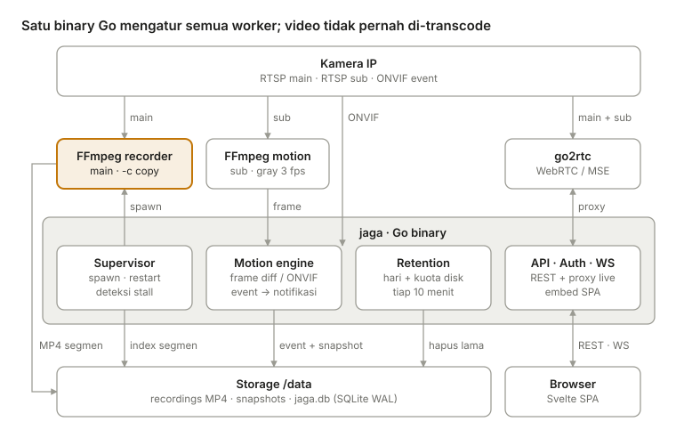
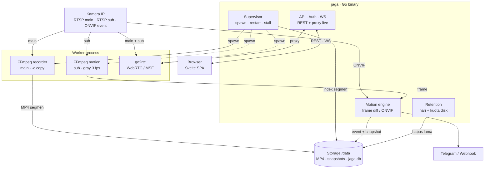

# Arsitektur sistem

Semua logika ada di satu proses Go; FFmpeg dan go2rtc berjalan sebagai child process yang dikelola Supervisor.

Supervisor juga men-spawn FFmpeg motion dan go2rtc (panahnya tidak digambar agar ringkas). Video kamera hanya di-copy ke disk dan ke browser; satu-satunya decoding terjadi di sub-stream resolusi rendah untuk motion.

### Alur data utama

1. **Recording**: kamera (main) → FFmpeg recorder `-c copy` → file MP4 per segmen → nama file dikirim lewat stdout ke Supervisor → baris `segments` di SQLite.
2. **Live view**: browser → API (cek sesi) → reverse proxy → go2rtc → kamera. WebRTC/MSE, tanpa transcode.
3. **Playback**: browser minta `/segments?from=&to=` → timeline → putar file MP4 via HTTP Range; export klip memakai concat demuxer (copy).
4. **Motion**: ONVIF event atau frame diff sub-stream → debounce → baris `events` + snapshot → notifikasi Telegram/webhook → push WebSocket ke browser.
5. **Retensi**: job periodik menghapus folder tanggal lama dan segmen tertua saat kuota disk terlampaui.
